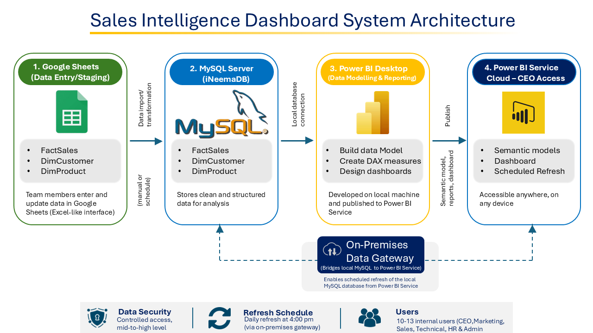
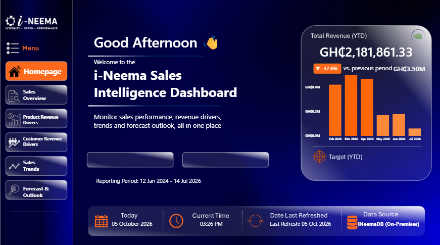
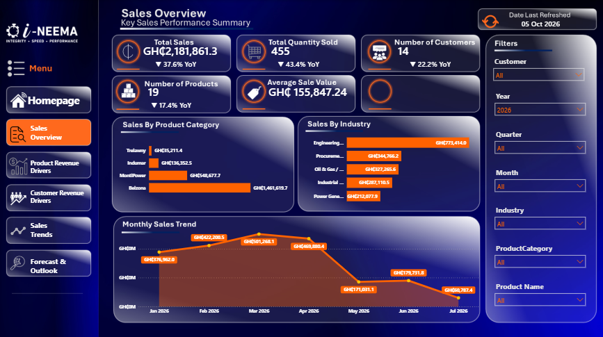
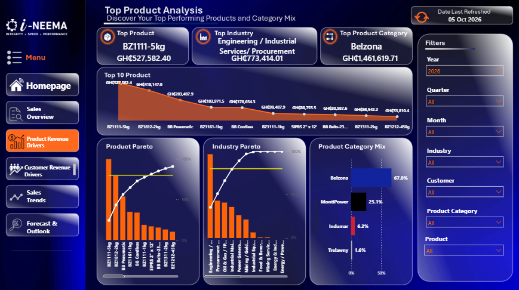
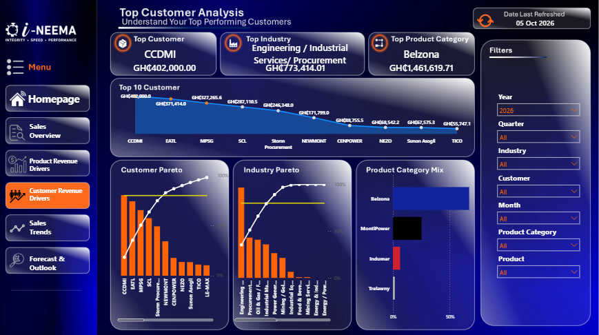
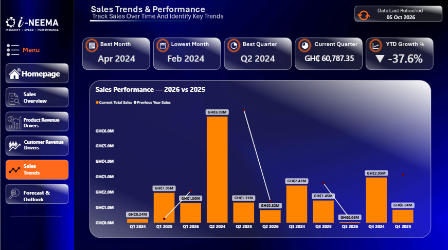
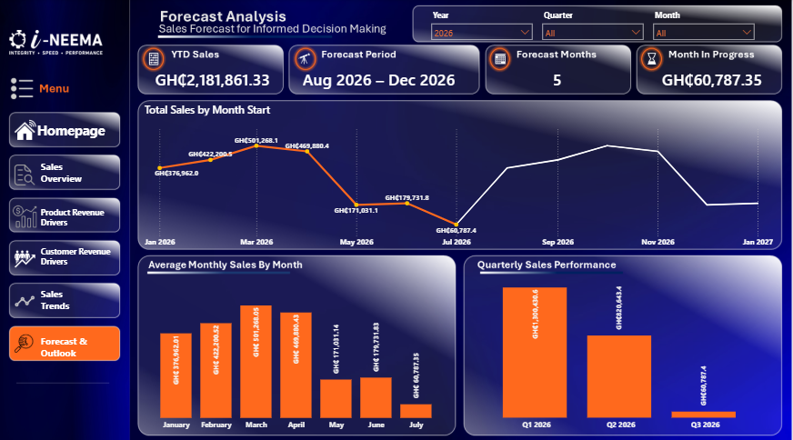

# i-Neema Sales Intelligence

An end-to-end business intelligence solution designed to centralize sales data, improve management visibility, automate reporting, and support data-driven decision-making at i-Neema Ghana Limited.

## Project Overview

The i-Neema Sales Intelligence project was developed to transform sales data from a manually maintained workflow into a centralized analytical system.

The solution connects structured data entry in Google Sheets to a MySQL database, Power BI Desktop, and Power BI Service. It provides management with interactive dashboards for monitoring sales performance, customer and product contribution, sales trends, and forecasting.

The project also includes automated data-entry notifications, SQL-based data validation, Power BI calculations, and an on-premises gateway supporting scheduled refreshes.

> **Confidentiality:** This project was developed using real business data. The underlying customer, product, and sales data is confidential and is therefore not included in this public repository. Dashboard screenshots, SQL structure, DAX measures, documentation, and architecture materials are provided to demonstrate the analytical and technical implementation.

---

## Business Problem

The sales reporting process required information from operational data sources to be organized and transformed before management could effectively analyze performance.

Key challenges included:

* Sales information requiring structured data management
* Need for centralized historical sales records
* Difficulty maintaining a consistent analytical data source
* Need for management-level visibility into sales performance
* Requirement for customer and product performance analysis
* Need to identify sales trends and revenue drivers
* Need for forecasting to support planning
* Requirement for automated dashboard refreshes
* Need for a controlled workflow for adding new customers, products, and sales records

The project addressed these challenges by creating a connected data and reporting architecture.

---

## Project Objectives

The main objectives were to:

1. Centralize sales data in a relational MySQL database.
2. Establish a structured data-entry workflow.
3. Create a reliable analytical data model.
4. Develop interactive Power BI dashboards.
5. Provide management-level sales KPIs.
6. Analyze customer, product, industry, and category performance.
7. Identify revenue concentration and major sales drivers.
8. Provide sales trend and forecasting analysis.
9. Automate data-entry notifications.
10. Enable scheduled Power BI refreshes through an on-premises gateway.
11. Document the complete analytical solution for maintainability and future development.

---

## Solution

The implemented solution follows this architecture:

**Google Sheets → MySQL (`iNeemaDB`) → Power BI Desktop → Power BI Service**

An On-premises Data Gateway connects the local MySQL database to Power BI Service, allowing the published semantic model to refresh from the organization's database.

### Architecture



### High-Level Data Flow

```text
Google Sheets
     │
     │ Structured data entry
     ▼
MySQL Database
     │
     │ Relational data model
     ▼
Power BI Desktop
     │
     │ Data modelling + DAX + visualisation
     ▼
Power BI Service
     │
     │ Published semantic model
     ▼
Management Dashboard
     
On-premises Data Gateway
     │
     └── Enables Power BI Service to refresh from local MySQL
```

---

## Technology Stack

| Technology               | Purpose                                                    |
| ------------------------ | ---------------------------------------------------------- |
| Google Sheets            | Structured operational data entry                          |
| Google Apps Script       | Automated email notifications                              |
| MySQL 8.0.46             | Relational database and central sales data store           |
| MySQL Workbench          | Database development and SQL testing                       |
| Power BI Desktop         | Data modelling, DAX and dashboard development              |
| Power BI Service         | Published dashboard and semantic model                     |
| On-premises Data Gateway | Secure connection between Power BI Service and local MySQL |
| DAX                      | Power BI calculations and analytical measures              |
| GitHub                   | Version control and project documentation                  |
| VS Code                  | SQL, Markdown and project documentation                    |

---

# Data Architecture

The database uses a simple dimensional structure consisting of:

```text
DimCustomer
     │
     │ CustomerID
     ▼
FactSales
     ▲
     │ ProductID
     │
DimProduct
```

### FactSales

The grain of the `FactSales` table is **one sales line item per row**.

Main fields include:

* `SalesID`
* `SalesDate`
* `CustomerID`
* `ProductID`
* `Quantity`
* `SALESAMOUNT`

### DimCustomer

Contains customer-level information:

* `CustomerID`
* `CustomerName`
* `Industry`

### DimProduct

Contains product-level information:

* `ProductID`
* `ProductCategory`

Foreign-key relationships between the fact and dimension tables help maintain referential integrity.

The complete schema is available in:

`sql/schema/iNeemaDB_schema.sql`

---

# Data Entry Workflow

Operational data is initially captured through structured Google Sheets.

The workflow contains separate structures for:

* Sales transactions
* Customers
* Products

### Sales Entry

The sales-entry workflow includes:

* Sales date
* Customer ID
* Product ID
* Quantity
* Sales amount
* Entry status
* Notification
* Notes

### Customer and Product Entry

New customers and products are captured through structured entry forms with controlled identifiers and entry-status fields.

Dropdowns are used for CustomerID and ProductID to reduce inconsistent manual entry.

### Automated Notifications

Google Apps Script was implemented to send email notifications for relevant new or submitted records.

The workflow was tested for:

* New sales
* New customers
* New products

---

# SQL Implementation

MySQL acts as the central relational data source for the reporting solution.

The SQL implementation covers:

* Data retrieval
* Filtering
* Sorting
* Pattern matching
* Data-quality checks
* Database validation

### SQL Query Library

The repository contains the following documented query sets:

```text
sql/
└── queries/
    ├── 01-basic-select.sql
    ├── 02-filtering.sql
    ├── 03-sorting-and-limiting.sql
    ├── 04-pattern-matching.sql
    └── 05-data-quality-checks.sql
```

Examples of analytical SQL techniques used include:

* `SELECT`
* `WHERE`
* `AND`
* `OR`
* `BETWEEN`
* `ORDER BY`
* `LIMIT`
* `LIKE`
* `IS NULL`
* `COUNT()`

The repository also contains the current database schema:

`sql/schema/iNeemaDB_schema.sql`

No stored procedures are currently implemented.

---

# Power BI Dashboard

The Power BI solution was designed as an interactive management reporting environment rather than a collection of isolated charts.

The dashboard includes:

* KPI cards
* Dynamic comparisons
* Conditional indicators
* Time-series analysis
* Product analysis
* Customer analysis
* Industry analysis
* Category analysis
* Pareto analysis
* Forecasting
* Interactive filters
* Navigation and bookmarks
* Dynamic page elements

The dashboard is structured into several analytical areas.

---

## 01 — Homepage

The homepage provides a management-level summary of current performance.

Key features include:

* Dynamic greeting
* Current date
* Current time
* YTD sales
* YTD growth comparison
* Directional growth indicators
* Conditional formatting
* Six-month sales trend
* Interactive navigation
* Dynamic bookmarks



---

## 02 — Sales Overview

The Sales Overview page provides a broader view of sales performance.

Key metrics include:

* Total Sales
* Total Quantity Sold
* Number of Customers
* Number of Products
* Average Sale Value

The page also provides:

* Monthly sales trends
* Sales by product category
* Sales by industry
* Interactive filtering



---

## 03 — Product Revenue Drivers

This page focuses on the products and categories contributing to revenue.

Analytical features include:

* Top 10 products
* Product Pareto analysis
* Product category contribution
* Top product KPIs
* Interactive filtering

The Pareto analysis helps identify products that account for a significant share of total revenue.



---

## 04 — Customer Revenue Drivers

The customer analysis page examines revenue contribution across customers.

Features include:

* Customer ranking
* Customer revenue contribution
* Customer Pareto analysis
* Top customer KPI
* Interactive customer and industry filtering



---

## 05 — Sales Trends Across Time

The time-analysis page focuses on historical sales performance and period-based comparisons.

It supports analysis across:

* Year
* Quarter
* Month
* Sales periods

The page helps identify stronger and weaker sales periods and provides context for performance changes over time.



---

## 06 — Forecast Analysis

The Forecast Analysis page combines historical sales performance with future-period forecasting.

The page includes:

* YTD Sales
* Forecast Period
* Forecast Months
* Month-in-progress information
* Historical monthly sales
* Forecast sales
* Average monthly sales
* Quarterly performance
* Year, quarter and month filtering

The Power BI forecasting functionality was also evaluated for seasonality during development.



---

# DAX and Analytical Measures

The project contains a documented DAX measure library covering the main analytical requirements of the dashboard.

The measure library includes calculations for:

### Sales Performance

* Total Sales
* Average Transaction Value
* Largest Sale
* Smallest Sale
* Sales Growth %
* Sales Growth Display
* Sales Growth Arrow
* Sales Growth Colour

### Year-to-Date Analysis

* YTD Sales
* YTD Sales LY
* YTD Growth %
* YTD Growth Display
* YTD Growth Color

### Customer Analysis

* Total Customers
* Customers LY
* Customer Growth %
* Customer Growth Display
* Customer Growth Colour
* Customer Rank
* Customer Sales
* Customer Revenue Contribution %
* Customer Pareto %

### Product Analysis

* Total Products Sold
* Products LY
* Product Growth %
* Product Growth Display
* Product Growth Colour
* Product Rank
* Product Revenue Contribution %
* Product Pareto %

### Industry Analysis

* Industry Rank
* Industry Revenue Contribution %
* Industry Pareto %

### Period Analysis

* Current Quarter Sales
* Current Quarter Sales LY
* Current Quarter Growth %
* Best Sales Month
* Weakest Sales Month
* Best Sales Quarter
* Monthly/Period Growth %

### Forecasting

* Forecast Sales
* Forecast Months
* Forecast Period
* Average Monthly Sales

The full measure library is available in:

`power-bi/measures/sales-intelligence-measures.dax`

---

# Forecasting

Forecasting was incorporated into the Power BI analytical layer to provide visibility into expected future sales performance.

The analysis compares historical monthly performance with forecast values and provides additional period-level context.

The forecasting analysis was also evaluated for seasonality rather than relying solely on a flat projection.

Forecasting should be treated as an analytical planning aid rather than a guarantee of future revenue.

---

# Automated Refresh and Deployment

A major objective of the project was to move beyond a static dashboard and establish a refreshable reporting environment.

### Deployment Architecture

```text
Local MySQL Database
        │
        ▼
On-premises Data Gateway
        │
        ▼
Power BI Service
        │
        ▼
Published Semantic Model
        │
        ▼
Management Dashboard
```

The On-premises Data Gateway was installed and registered as:

`i-Neema-PowerBI-Gateway`

The MySQL database connection was established through the gateway using the `iNeemaDB` database.

The semantic model was connected to the gateway and configured for scheduled refresh.

### Refresh Schedule

The production reporting environment was configured for:

**Daily refresh at 4:00 PM UTC/GMT**

The refresh architecture was tested by adding new customers, products and sales records and confirming that the updated data appeared in Power BI following refresh.

During implementation, a gateway connectivity issue was investigated and resolved by correcting the MySQL gateway connection configuration, including the encrypted/TLS connection.

---

# Testing and Validation

Testing was performed throughout the implementation rather than only after dashboard development.

Validation activities included:

* Database schema validation
* Foreign-key validation
* Data-entry workflow testing
* Customer/Product dropdown testing
* Email notification testing
* SQL query validation
* Data-quality checks
* Power BI measure validation
* Dashboard visual validation
* Gateway connectivity testing
* Manual refresh testing
* Scheduled refresh configuration
* New-record refresh validation

The repository contains the testing and validation documentation in:

`documentation/10-testing-and-validation.md`

---

# Key Analytical Capabilities

The completed solution supports management analysis across several dimensions.

### Sales

* Total sales performance
* Sales growth
* YTD performance
* Monthly trends
* Quarterly performance
* Average transaction value

### Customers

* Customer ranking
* Customer revenue contribution
* Customer Pareto analysis
* Top customers

### Products

* Top products
* Product revenue contribution
* Product Pareto analysis
* Product category performance

### Industry

* Industry revenue contribution
* Industry ranking
* Industry Pareto analysis

### Forecasting

* Forecast sales
* Forecast periods
* Monthly performance comparison
* Seasonality-aware forecasting analysis

---

# Repository Structure

```text
i-neema-sales-intelligence/
│
├── assets/
│   └── architecture/
│       └── i-neema-sales-intelligence-architecture.png
│
├── data/
│   └── README.md
│
├── documentation/
│   ├── 01-project-overview.md
│   ├── 02-business-requirements.md
│   ├── 03-solution-architecture.md
│   ├── 04-data-architecture.md
│   ├── 05-data-entry-workflow.md
│   ├── 06-sql-database.md
│   ├── 07-power-bi-dashboard.md
│   ├── 08-forecasting.md
│   ├── 09-deployment-and-refresh.md
│   ├── 10-testing-and-validation.md
│   └── 11-limitations-and-future-improvements.md
│
├── power-bi/
│   ├── measures/
│   │   └── sales-intelligence-measures.dax
│   │
│   └── screenshots/
│       ├── 01-homepage.png
│       ├── 02-sales-overview.png
│       ├── 03-product-revenue-drivers.png
│       ├── 04-customer-revenue-drivers.png
│       ├── 05-sales-trends-across-time.png
│       └── 06-forecast-analysis.png
│
├── sql/
│   ├── procedures/
│   │   └── README.md
│   │
│   ├── queries/
│   │   ├── 01-basic-select.sql
│   │   ├── 02-filtering.sql
│   │   ├── 03-sorting-and-limiting.sql
│   │   ├── 04-pattern-matching.sql
│   │   └── 05-data-quality-checks.sql
│   │
│   └── schema/
│       └── iNeemaDB_schema.sql
│
└── README.md
```

> **Note:** The Power BI `.pbix` file is intentionally not included because the report contains confidential business data. The repository instead provides screenshots, DAX measures, SQL implementation, architecture documentation, and technical documentation of the solution.

---

# Security and Confidentiality

The project was developed using real organizational data.

To protect confidential information:

* Raw customer data is not included.
* Raw product data is not included.
* Raw sales transactions are not included.
* The Power BI `.pbix` file is not included.
* The public repository contains the database structure rather than the production dataset.
* Analytical implementation is demonstrated through SQL, DAX, screenshots, architecture, and documentation.

This approach allows the technical implementation to be demonstrated without exposing sensitive business information.

---

# Limitations and Future Improvements

The current implementation provides a strong foundation but can be expanded further.

Potential future improvements include:

### Data Engineering

* Additional automated ingestion processes
* More advanced data-quality monitoring
* Expanded historical data-management procedures
* More automated database maintenance

### Power BI

* Additional executive KPI pages
* More advanced drill-through experiences
* Expanded anomaly detection
* More sophisticated forecasting models
* Additional scenario analysis

### Database

* Additional reusable SQL procedures where appropriate
* More extensive indexing as data volume grows
* Expanded validation and monitoring queries

### Automation

* Additional workflow notifications
* Automated data-quality alerts
* More comprehensive refresh monitoring

These improvements can be introduced as the reporting environment and business requirements evolve.

---

# Project Outcome

The project established a connected sales intelligence environment spanning data entry, database management, business intelligence, forecasting, deployment, and automated refresh.

The resulting solution demonstrates practical experience in:

* SQL
* Relational database design
* Data modelling
* Power BI
* DAX
* Business intelligence
* Dashboard development
* Forecasting
* Data-quality validation
* Workflow automation
* On-premises BI deployment
* Scheduled data refresh
* Technical documentation

Rather than functioning as a standalone visualization, the solution provides an end-to-end framework for turning operational sales data into management-ready insights.

---

## Portfolio Note

This repository is a **sanitized representation of a real business intelligence implementation**. Confidential production data and the original Power BI report are intentionally excluded.

The purpose of the repository is to demonstrate the analytical thinking, technical architecture, implementation methods, and documentation practices used to build the solution.
